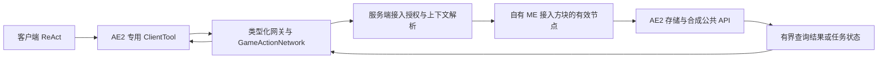

# AE2 拓展 Mod 可行性研究

调研日期：2026-10-13。对象：AI-Factory（Minecraft 1.20.1 / Forge / Kotlin）与用户指定的 AE2 `fix-8329-forge-1.20.1` 分支。

## 1. 结论与建议

**可行。当前工程可以作为独立 AE2 addon 开发，不需要把项目改为 Java、不需要迁移 NeoForge，也不需要 fork AE2。** AE2 提供联网节点、统一存储、存储单元、自动合成、部件和升级卡等公开 Java API，Kotlin/JVM 可以直接调用。

这属于“源码与发布制品支持的可行性结论”，不是“已经完成接入并通过游戏验证”。本次只新增研究文档，没有修改依赖、入口、网络协议或游戏功能，没有启动客户端或服务端。

建议路线：

1. **保持独立 Mod，优先依赖 `appeng.api.*`。** 新内容归入 `ai_factory` 命名空间；不复制 AE2 实现、纹理或模型。
2. **以指定分支固定提交研究接口，以正式 Forge 发布版作为后续接入候选。** 本次查到的 Modmaven 最新 Forge 版本为 `15.4.11`；它包含指定分支修复。不要把分支名当 Maven 版本。
3. **对 AI-Factory，优先做自有“ME 接入方块”与只读网络查询，再接自动合成。** 客户端模型继续只决策，ME 操作由服务端机制执行；不以作弊给予物品或命令执行模拟 ME 行为。
4. **不建议第一步做自定义合成 CPU、修改原版终端/样板供应器、解除存储类型限制或新增资源种类。** 这些目标要么缺少直接公开替换点，要么有明显内部耦合与持久化成本。

用户未指定具体拓展功能。下文的路线是可选方向与推荐顺序，不代表已决定实现全部功能。

## 2. 研究基线：指定分支与正式制品不是同一件事

### 2.1 固定源码身份

指定分支当前指向：

- 提交：[`b98ea1f712a1923fbcb99d1e028a5b382b98cf37`](https://github.com/AppliedEnergistics/Applied-Energistics-2/commit/b98ea1f712a1923fbcb99d1e028a5b382b98cf37)。
- 提交日期：2025-01-14。
- 提交说明：`Fix #8329: StorageService updates getting more expensive over time (#8331)`。
- 修复点：网络库存缓存清空时，额外清理 `KeyCounter` 的空子映射，并移除原有 backbuffer，避免历史上出现过的大量物品类型持续拖慢缓存更新。
- `gradle.properties` 的 `version=0.0.0` 是源码构建默认值；构建脚本根据 `TAG=forge/v...` 等环境变量设置发布版本，不能用 `0.0.0` 推断真实发行版。

该分支是具体性能修复的源码基线，不是 addon 必须依赖的特殊运行环境。新扩展不应访问修复涉及的 `appeng.me.service.StorageService` 内部字段，更不应长期持有或修改它返回的库存缓存。

### 2.2 与本项目的兼容性

| 维度 | AI-Factory 当前配置 | 指定 AE2 提交 | 判断 |
| --- | --- | --- | --- |
| Minecraft | 1.20.1 | 1.20.1，范围 `[1.20.1,1.20.2)` | 匹配 |
| Forge | 47.4.10 | 构建用 47.1.47，要求 `[47.1.3,)` | 当前版本满足声明范围；共同运行尚未验证 |
| Java 字节码 | 17 | Java toolchain 17 | 匹配；发布 API 类 major version 实测为 61 |
| Gradle 启动 JVM | 本机 JDK 21 | 不必与 addon 使用相同启动 JVM | 保持现有配置；游戏/API 仍按 Java 17 使用 |
| Mod 实现语言/加载器 | Kotlin 2.2.21 / KFF 4.12.0 | Java / `javafml` | 各自使用自己的加载器，可通过 JVM API 互操作 |
| 构建插件 | ForgeGradle 6 | `net.neoforged.moddev.legacyforge` 2.0.57-beta | 构建插件可以不同，无需照搬 AE2 构建系统 |
| 映射 | official 1.20.1 | Forge 发行 JAR | 本项目使用 `fg.deobf(...)` 转为开发映射 |

`legacyforge` 的插件名称包含 NeoForged，**不意味着这份 AE2 是 NeoForge 制品**。其目标、坐标和 `mods.toml` 均是 Forge。不得因此换成 NeoForge 或 Fabric 依赖。

证据：[指定提交版本属性][ae-properties]、[构建脚本][ae-build]、[插件配置][ae-settings]；本地 `gradle.properties`、`build.gradle`、`src/main/resources/META-INF/mods.toml`。

### 2.3 正式版候选与新增硬依赖

本次 Modmaven 元数据中的最新 Forge 发布版为 `appeng:appliedenergistics2-forge:15.4.11`。其标签指向 `1c2f96e70ca6b61e8120482923e9775d772fd9e7`。GitHub compare 返回：相对指定提交 `ahead_by=49`、`behind_by=0`，merge base 就是指定提交，因此它包含该修复。[版本元数据][maven-metadata] / [标签][release-tag] / [提交比较][release-compare]

**15.4.11 额外要求 GuideME，不能照抄指定分支 README 的“无额外硬依赖”。** 实际发行 JAR 的元数据要求：

| 必需 Mod | 版本要求 | 安装位置 |
| --- | --- | --- |
| Minecraft | `[1.20.1,1.20.2)` | 客户端与服务端 |
| Forge | `[47.1.3,)` | 客户端与服务端 |
| GuideME | `[20.1.7,20.2.0)` | 客户端与服务端 |
| Kotlin for Forge | AI-Factory 自身要求 4.12.x，现有 loader 范围 `[4.12,5)` | 客户端与服务端；不是 AE2 自身依赖 |
| AE2 | 后续接入候选 15.4.11 | 客户端与服务端 |

GuideME 的 Maven 坐标为 `org.appliedenergistics:guideme:20.1.7`，在 Maven Central 可取得；本次下载核验了其 Forge JAR。GuideME 自身要求 Forge `[47.1.0,)`、Minecraft `[1.20.1]`。JEI、Jade、The One Probe 在 AE2 元数据中为可选，不是最小接入必需项。[正式版属性][release-properties] / [正式版元数据源码][release-mods] / [GuideME POM][guideme-pom]

## 3. 依赖接入方案

### 3.1 建议的最简单 ForgeGradle 方案

以下是**后续实现时的建议配置，未写入本项目、未执行 Gradle 依赖解析或编译验证**。它依据 ForgeGradle 6 官方依赖方式和已核验的发布坐标编写。[ForgeGradle 依赖说明][fg-dependencies]

在现有 Groovy `build.gradle` 中合并，而不是替换整个文件：

```groovy
repositories {
    mavenCentral()
    maven {
        name = 'ModmavenAE2'
        url = 'https://modmaven.dev/'
        content { includeGroup 'appeng' }
    }
}

dependencies {
    implementation fg.deobf('appeng:appliedenergistics2-forge:15.4.11')
    runtimeOnly fg.deobf('org.appliedenergistics:guideme:20.1.7')
}
```

这里选择完整 AE2 制品编译并在开发环境运行，避免最初接入时拆分 classpath；**业务代码仍只应使用公开 API**。GuideME 的 POM 可取得，但 AE2 15.4.11 的 POM 本身没有列出运行 Mod 依赖，不能假设它会通过 Maven 自动拉入 GuideME。

`implementation` 不等于把 AE2 打入 AI-Factory JAR。发布时玩家仍需分别安装依赖；不要 shadow AE2、GuideME 或额外打包一套 Kotlin 标准库。

AE2 同时发布 `:api` classifier，含公开 API 的类和源码，但不是可加载的完整 Mod。它可用于后续收紧编译依赖边界；不能单独放进 `mods` 目录代替 AE2。不要照抄 README 中的 `appliedenergistics2-fabric` / `modCompileOnly` 示例，这不是本项目 ForgeGradle 6 的配置。

### 3.2 Mod 元数据

如果最终把 AI-Factory 定位为“必须安装 AE2 的拓展”，建议在 `mods.toml` 中新增硬依赖，首次验证先精确锁定版本：

```toml
[[dependencies.${mod_id}]]
modId="ae2"
mandatory=true
versionRange="[15.4.11]"
ordering="AFTER"
side="BOTH"
```

在这个版本完成验收后，再根据实际兼容性扩大范围；`[15.4.11,16)` 可以作为同一 API major 的候选范围，但不代表未来所有版本已经通过测试。`ordering="AFTER"` 也不能替代 Forge 注册事件与 AE2 各扩展注册表的时序要求。

如果希望保留 AI-Factory 在无 AE2 环境下的现有功能，则需选择“可选集成”：`mandatory=false`、独立集成包、按 Mod 是否存在隔离加载，公共入口不得提前引用 AE2 类。仅在运行时包一层 `if` 不足以防止类加载错误。是否硬依赖属于产品定位，不是技术可行性阻碍；本次未修改现有定位。

### 3.3 不建议使用分支源码作为日常依赖

分支没有以分支名命名的已核验 Maven 发布坐标。确实需要该分支独有行为时，应固定提交，自行构建/发布到本地仓库，或通过 ForgeGradle 的 `flatDir` 加 `fg.deobf` 使用完整发行 JAR，并为测试制品使用可辨识版本。不能声称这一步已验证，也不能假设源码克隆后能直接产生 15.4.11。

当前没有发现必须依赖该特殊分支、而不能使用正式版的 addon 需求。

## 4. 扩展能力与风险矩阵

下表的成本为 **[INFERENCE]：基于接口数量、资源需求和生命周期的相对评估**，不是开发工期承诺。

| 目标 | 主要公开入口 | 可行性 / 相对成本 | 边界与主要风险 |
| --- | --- | --- | --- |
| 查询库存、可合成物品、CPU 状态 | `IStorageService`、`ICraftingService` | 高 / 低至中 | 真实网格只在服务端；查询前验证玩家接入资格；结果需有界 |
| 新增联网方块 | `GridHelper`、`IManagedGridNode`、`IInWorldGridNodeHost` | 高 / 中 | 加载、首次 tick、NBT、移除和区块卸载都要处理 |
| 新增标准物品/流体磁盘 | `IBasicCellItem` | 高 / 低至中 | 单个 `AEKeyType`，标准实现类型数 1–63；不能简单把上限改为无限 |
| 新增特殊磁盘 | `StorageCell`、`ICellHandler`、`StorageCells` | 高 / 中至高 | 自行实现持久化、容量、状态、耗能和必要 GUI |
| 把自有库存挂进 ME 网络 | `IStorageProvider`、`IStorageMounts`、`MEStorage` | 高 / 中 | 挂载刷新、优先级、外部变更通知、SIMULATE 语义 |
| 请求既有自动合成 | `ICraftingService`、`ICraftingRequester`、`ICraftingLink` | 高 / 中至高 | 异步计划、CPU/材料变化、产物接收、任务恢复 |
| 提供图样或加工机器 | `ICraftingProvider`、`IPatternDetails`、`ICraftingMachine` | 高 / 高 | 区分网络图样提供方与相邻加工接收方；图样持久化和输入消费 |
| 新增线缆总线部件 | `IPart`、`IPartItem`、`PartHelper`、`PartModels` | 高 / 高 | 模型提前注册、碰撞箱、主机交互、状态同步；内部基类依赖风险 |
| 新增升级卡与自有机器升级槽 | `Upgrades`、`UpgradeInventories` | 高 / 低至中 | 接受卡片不等于实现效果；效果应由自有机器读取并执行 |
| 新增资源种类 | `AEKey`、`AEKeyType`、`AEKeyTypes.register` | 有公开入口 / 高 | 序列化、数量单位、显示、存储与机器兼容需要专项设计；本次未完成端到端研究 |
| 新增每网格服务 | `GridServices.register`、`IGridServiceProvider` | 有公开入口 / 高 | 加载期注册、单一构造器、服务依赖与网络拆分/合并生命周期 |
| 修改原版终端、供应器或合成 CPU 实现 | 多为 `appeng.parts.*`、`appeng.blockentity.*`、内部 crafting 类 | 无通用公开替换入口 / 高风险 | 不是绝对做不到，但需逐目标确认特殊扩展点；Mixin/内部继承/fork 不应作为默认路线 |

来源：[节点 API][managed-node]、[存储服务][storage-service]、[标准磁盘][basic-cell]、[合成服务][crafting-service]、[部件接口][part-api]、[升级注册表][upgrades]、[资源类型注册][key-types]、[网格服务注册][grid-services]。

## 5. 最小独立联网方块路径

建议直接继承 Minecraft 的 `BlockEntity`，实现公开接口，而不是继承 `appeng.blockentity.grid.AENetworkBlockEntity`。

1. 使用 `GridHelper.createManagedNode(owner, listener)` 创建 `IManagedGridNode`。配置 `setInWorldNode(true)`、暴露方向、空闲 AE/t、可视物品和按玩法需要设置的 `GridFlags.REQUIRE_CHANNEL`。
2. 方块实体实现 `IInWorldGridNodeHost`，按面返回节点。AE2 的 `GridHelper.getNodeHost` 可直接识别该接口；这条路径不需要导入内部 Forge capability 常量。
3. 加载 NBT 时调用 `loadFromNBT`，必须早于节点 `create`；保存时调用 `saveToNBT`。
4. 在合适的加载回调中通过 `GridHelper.onFirstTick(blockEntity, callback)` 延迟创建，在进入 ticking chunk 后调用 `create(level, pos)`，不要在字段初始化或刚加入世界时立即建网。
5. 在 `setRemoved`、`onChunkUnloaded` 中调用 `destroy`；监听 `onSaveChanges` 标记宿主存档，监听 `onStateChanged` 更新自有状态与客户端显示。
6. 操作前确认服务端、节点存在且 active。`isReady` 仅表示节点已创建；有节点不等于有电、有通道或网络已完成启动。客户端可以持有托管对象，但没有真实网格。
7. `destroy` 后不复用该托管节点；如宿主需要重新进入世界，必须重新建立正确的托管节点与初始化状态，不能继续缓存旧 `IGrid` / `IGridNode`。

相邻 in-world 节点由 AE2 自动尝试连接；虚拟节点则通过 `GridHelper.createConnection` 显式连接。主机应只在允许的面暴露节点，不能只依赖 UI 表示面配置。

官方 `AENetworkBlockEntity` 可作为生命周期阅读样例，`DriveBlockEntity` 可作为存储挂载样例；它们不是本方案建议继承的稳定 API。[GridHelper][grid-helper] / [节点宿主接口][node-host] / [官方生命周期样例][network-be] / [磁盘仓样例][drive-be]

## 6. 存储读取、转移与自定义磁盘

### 6.1 网络读取

通过 `node.getGrid().getStorageService()` 获取服务：

- `getCachedInventory()` 返回 `KeyCounter`，每 tick 至多更新一次，**不是副本，不可修改**，同 tick 变更可能尚未反映。适合普通查询。
- `getInventory()` 返回 `MEStorage`；`getAvailableStacks(KeyCounter)` 可主动枚举。不要每 tick 或每个模型步骤都遍历整个网络。
- 可合成物品不等于已存库存。通过 `getCraftingService().getCraftables(AEKeyFilter)` 单独查询，不能只看库存推断是否能合成。
- 在服务端构造有界响应 DTO，不把 `KeyCounter`、网格对象或原始全量 NBT 跨线程/网络传递。[存储服务契约][storage-service]

### 6.2 转移物品/流体

核心签名：

```java
long insert(AEKey what, long amount, Actionable mode, IActionSource source);
long extract(AEKey what, long amount, Actionable mode, IActionSource source);
```

`AEKey` 表示“是什么”，`long amount` 表示数量；不要使用旧教程的 `IAEItemStack` / `IStorageChannel`。`Actionable.SIMULATE` 不能修改状态，`MODULATE` 才执行；返回值是实际转移量，不是布尔值。

玩家或机器从网络执行需耗能的取放时，优先使用 `StorageHelper.poweredExtraction` / `poweredInsert`，以免直接调用 `MEStorage` 绕过该路径的能量结算。它们仍不替 addon 完成玩家授权，也不保证背包与 ME 网络之间的跨库存原子事务。必须按真实返回量处理目标容量、部分转移和剩余物品；不能把模拟成功当作随后执行一定成功。[MEStorage][me-storage] / [StorageHelper][storage-helper]

将自有库存加入网格时，用节点 `addService(IStorageProvider.class, provider)`，在 `mountInventories` 中 `mount(storage, priority)`。存储集合或优先级变化后用 `IStorageProvider.requestUpdate(managedNode)` 重新挂载。外部直接改变库存时还需按存储通知/缓存契约处理；频繁 `invalidateCache()` 是昂贵操作，不是通用同步方案。[存储提供方][storage-provider]

### 6.3 标准与特殊存储单元

普通容量扩展首选让自有物品实现 `IBasicCellItem`：AE2 自动接管内部库存与 NBT，无需再注册 `ICellHandler`。主要属性是 `getKeyType`、`getBytes`、`getBytesPerType`、`getTotalTypes`、`getIdleDrain`。接口声明的约束包括单一资源种类、字节数为 8 的倍数、类型数 1–63。[标准磁盘][basic-cell]

超出标准语义的特殊单元才自行实现 `StorageCell` 与 `ICellHandler`，通过 `StorageCells.addCellHandler` 注册，处理 `persist` / `ISaveProvider.saveChanges`、满盘状态、容量和能耗。需要 ME 箱子打开特定界面时还要处理 GUI handler；磁盘仓外观需要客户端模型注册及自有资源。[单元注册表][storage-cells]

注册时序需逐入口处理：`StorageCells.addCellHandler` 文档要求 AE2 已处理 common setup；不要因为方法带 `synchronized` 就在任意时期注册。`PartModels` 则要求更早注册，不能统一挪到 common setup。

## 7. 自动合成：可接入，但不是一次同步调用

### 7.1 请求现有图样

固定提交的关键接口为：

```java
Future<ICraftingPlan> beginCraftingCalculation(
    Level level, ICraftingSimulationRequester simRequester,
    AEKey craftWhat, long amount, CalculationStrategy strategy);

ICraftingSubmitResult submitJob(
    ICraftingPlan job, @Nullable ICraftingRequester requestingMachine,
    @Nullable ICraftingCPU target, boolean prioritizePower, IActionSource src);
```

正确路径：

1. 验证目标网格可用、调用者被授权、请求数量和物品/流体身份合法，取得 action source。
2. 开始计算。**不能在服务端主线程阻塞 `Future.get()`**；AE2 的计算受服务端 tick 推进，应在后续服务端调度中观察完成，再读取结果。
3. 检查计划是否为缺料模拟，展示 `missingItems` / 所需 bytes 等信息。计划是计算时状态，不是预留库存。
4. 回到服务端主线程重新检查接入上下文与网格状态，再提交；正确处理 CPU 不存在、忙、离线、容量不足、材料变化等 `ICraftingSubmitResult` 错误。
5. 如果只触发独立任务，`requestingMachine=null` 可形成 standalone 任务；不能假设这种任务返回可持久化的 requester link。
6. 如果接入方块要接收产物或恢复任务，实现 `ICraftingRequester` 并作为节点服务注册。`insertCraftedItems` 返回实际接收量，正确实现 SIMULATE；`jobStateChange` 处理完成/取消并清理任务。
7. 用 `ICraftingLink.writeToNBT` 保存任务；读档时用公开的 **`StorageHelper.loadCraftingLink(tag, requester)`** 恢复，并通过 `getRequestedJobs()` 暴露链接，让 AE2 在区块重载/网格变化后重新连接。不要自己构造内部 `CraftingLink` 或伪造链接实现。

来源：[合成服务][crafting-service]、[请求方][crafting-requester]、[任务链接][crafting-link]、[恢复工具][storage-helper]。

`ICraftingCPU` 应视为已有 CPU 的公共视图。固定提交的内部提交实现对 `CraftingCPUCluster` 有类型判断；新增一个自有 `ICraftingCPU` 实现并不能自动变成 AE2 能调度的 CPU。对 link 也应保存/恢复 AE2 返回的实例，不自建实现。[合成服务实现][crafting-impl]

### 7.2 提供新图样或加工能力

这是另一类扩展，不等同于发起合成：

- 联网的图样提供方实现 `ICraftingProvider`：公开可用图样、忙闲状态、接收 `pushPattern`，变更时调用 `requestUpdate`。
- 相邻加工接收方实现 `ICraftingMachine` 并暴露对应 Forge capability，可被 AE2 供应器识别。它不一定需要同时自己当图样提供方。
- 自定义图样通过 `IPatternDetails` / decoder 注册接入；其 `equals` / `hashCode` 和编码持久化必须保证重载后能识别同一图样。能用标准处理图样表达时，不必创造新图样格式。

这条路线还涉及输入物品真实消费、机器忙闲、产物回流和区块卸载，建议在请求现有合成稳定后再考虑。[图样提供方][crafting-provider] / [加工机器][crafting-machine]

## 8. 部件、升级卡与公开边界

- 自定义总线部件实现 `IPart`，物品实现 `IPartItem`，可用 `PartHelper.usePartItem` 接入放置。生命周期、碰撞箱、NBT/网络同步、模型状态都由 addon 负责；`IPartHost` 是 AE2 提供的宿主，不应自建替代宿主。
- `PartModels.registerModels` 必须在 pre-init/构造期完成；注册表冻结后调用会失败。客户端动态渲染与服务端节点逻辑必须隔离。[部件接口][part-api] / [模型注册][part-models]
- 升级卡可通过 `Upgrades.createUpgradeCardItem` 创建，用 `Upgrades.add(card, machineItem, maxCount)` 关联自有机器，用 `UpgradeInventories.forMachine` 创建槽位并自行保存。注册卡片到原版机器只改变“能否插入”，**不会让原版机器自动理解自定义卡的业务效果**。[升级注册][upgrades] / [升级库存][upgrade-inventories]
- 优先使用 `appeng.api.*`。`appeng.capabilities.Capabilities` 是 Forge 对接中可见但不在 API 包的常量类；必要时隔离在集成适配层。
- `appeng.parts.AEBasePart`、`appeng.blockentity.*`、`appeng.me.*`、`appeng.crafting.*` 是内部实现，公开 Java 可见性不等于兼容保证。阅读官方代码作为样例，不等于应该继承它。
- 部分 public 接口带 `@ApiStatus.NonExtendable`，只能消费实现；不能只按包名或类名决定可否自行实现。API JAR 中名为 `InternalInventory` 的公开库存接口也不能仅因名字含 Internal 就被误判。

## 9. 与 AI-Factory 现有架构结合

### 9.1 当前已有的承接点

仓库已经不是只有日志入口的空框架：本次读取确认存在 `ClientTool`、`ToolManager`、`GameActionNetwork`、`GiveItemMechanism`、`ExecuteCommandMechanism`，公共入口在 common setup 的 `enqueueWork` 中注册网络。现有设计文档也规定客户端决策、服务端执行。[本地架构文档](./客户端ReAct与Tool架构设计.md)

因此 AE2 能力可以延续已有分层，而不是再增加一套 Agent 或 RPC 系统：



推荐的首个能力是按授权接入点查询库存与可合成项。候选 Tool 名可为 `ae2_query_inventory`、`ae2_query_craftables`，之后才是 `ae2_request_crafting`。这些是接口设计建议，尚未注册或实现。

客户端不传“网格对象”、任意节点 ID 或可信玩家 UUID；服务端根据网络包的真实 sender 与授权接入点重新解析。查询按过滤条件/页大小返回紧凑结果，避免把整个网络和全部 NBT 发给模型。相同物品的不同 NBT 变体必须有明确识别方式，仅有资源 ID 不一定足以定位 `AEItemKey`。

目前 `GameActionNetwork.PROTOCOL_VERSION="2"` 且两端要求精确匹配；新增消息/结果模型时需要显式评估协议升级和包长度限制。本次未改变协议。

### 9.2 权限与线程：不能沿用旧 AE2 安全终端教程

**指定提交已没有原版安全系统。** `appeng.api.networking.security` 目录只含 `IActionSource` 与 `IActionHost`，不存在可用的 `ISecurityService` / `SecurityPermissions`。源码注释和 API.md 中仍残留“security station/system”措辞，不能据此设计一个实际不存在的权限调用。[安全包目录][security-directory] / [上游移除讨论 #7116][security-removal]

`IActionSource.ofPlayer(player, host)` 标注行为来源，并参与 CPU 的玩家/机器选择等逻辑；**不是玩家授权校验器**。`setOwningPlayer` 的旧注释也不代表已有网格访问控制。

addon 自己定义并执行授权：接入方块绑定、玩家可交互范围、对应维度与已加载区块、所有权/服务器策略等。不能默认任意在线玩家可查询全服网格，更不能以客户端“用户确认过”代替服务端验证。领地或第三方安全 Mod 是否约束这些操作需另做兼容研究；`mayInteract` 单独不保证覆盖所有保护规则。

网格读写、节点解析和 `submitJob` 在服务端主线程执行；模型 HTTP、协程和 UI 保留在客户端。异步计算完成后，不从 `Dispatchers.IO/Default` 直接操作世界或网格。断线、接入方块卸载、网格拆分以及任务取消都要有明确状态处理；请求超时不等于已提交的合成任务被撤销。

## 10. 实施顺序与后续验收门槛

这些是后续实施的验收要求，不是本次已经完成的功能。

| 阶段 | 最小真实交付 | 必须验证的行为 |
| --- | --- | --- |
| A：依赖接入 | Forge 15.4.11 + GuideME + KFF 可共同加载，元数据正确 | Gradle 解析/构建；客户端与独立服务端加载；发行 JAR 不意外包含 AE2 类 |
| B：联网方块与只读查询 | 自有接入方块接线，授权玩家得到实际库存和可合成项 | 断电、通道不足、网络启动、拒绝越权、区块卸载/重载、跨维度/远距离请求 |
| C：自动合成请求 | 计算计划、提交真实任务、回报真实状态 | 缺料、无 CPU、CPU 忙/离线/容量不足、计算中断；拒绝时无新任务 |
| D：接收与持久化 | 接入方块收到真实产物并恢复任务 | 缓冲区满、部分接收、SIMULATE 不变状态；存档重启、卸载重连、完成/取消清理 |
| E：按产品目标新增内容 | 选择磁盘、部件、卡片或加工能力之一 | 对应模型/翻译/配方/掉落、服务端行为与实际生存模式资源守恒 |

不以编译成功代替联网与权限验证，不以 `test NO-SOURCE` 代替业务验证，不通过 `/give` 造出产物来证明合成接口成功。

当前阶段只完成探索，未运行游戏。后续需要启动独立服务端时，应先由使用者阅读并接受 EULA；不能让脚本代替接受，也不能让客户端与服务端同时修改同一世界。

## 11. 本次实际验证与明确限制

### 11.1 已执行的证据检查

本次运行了内存中的制品核验程序：实际 HTTP 下载 JAR，以 ZIP 解析 `mods.toml`，检查 API 类字节码，并对发布 API JAR 的内嵌 Java 源与固定提交进行比较；没有把 JAR 或探针脚本留在工程中。

| 检查对象 | 实际结果 |
| --- | --- |
| AE2 15.4.11 完整 Forge JAR | HTTP 200；8,423,085 字节；含 `mods.toml`；Mod ID `ae2` |
| AE2 15.4.11 API JAR | HTTP 200；628,054 字节；含 GridHelper、IManagedGridNode、MEStorage、StorageHelper、ICraftingService；不含 `mods.toml` |
| Java 目标 | 两个 JAR 的 `IManagedGridNode.class` major version 均为 61，即 Java 17 |
| GuideME 20.1.7 JAR | Maven Central HTTP 200；4,661,372 字节；Mod ID `guideme`；上述 MC/Forge 依赖已展开 |
| 发布版与指定修复的关系 | GitHub compare 为 ahead 49 / behind 0，指定提交为 merge base |
| 抽样 API 源码一致性 | 发布 API JAR 与固定提交的 7 个源码文件逐字一致，比较时归一化 CRLF/LF |

抽样文件是 `GridHelper`、`IManagedGridNode`、`IStorageService`、`MEStorage`、`StorageHelper`、`IBasicCellItem`、`ICraftingService`。**这不是全量 API/实现一致性认证。**

制品 SHA-256：

```text
appliedenergistics2-forge-15.4.11.jar
679a70c243180d9a8fe2352f8874840c8bd9715b7f3f3dc0084d8b9b2efd48e6

appliedenergistics2-forge-15.4.11-api.jar
7c763e8460add891220c94ac3ae0b5210102a07c4ee3611da094797fbd34b28a

guideme-20.1.7.jar
8d46ca79ebdc77899c4ae5d5bd8c3c7bdd177426f8a677e697c9656d9120249b
```

下载来源：[AE2 完整 JAR][ae-jar]、[AE2 API JAR][ae-api-jar]、[GuideME JAR][guideme-jar]。以上是获取到的内容摘要，不是上游数字签名验证。

### 11.2 未验证项与旧文档陷阱

- 未修改/运行本项目 Gradle 依赖配置，未编译任何 AE2 集成代码，未运行游戏；共同加载、实际联网、生产环境重混淆后的调用仍需阶段 A/B 验收。
- 未专项验证自定义资源类型的终端渲染、全部第三方保护 Mod、所有后续 AE2 15.x 版本或其他平台。
- 指定分支 README 的 Fabric 坐标、API.md 的 `IGridHelper` / `IManagedNode` / `StateChangeReason` / `IStorageGrid` 等引用并不完全对应当前代码。实际分别应核对 `GridHelper`、`IManagedGridNode`、`IGridNodeListener.State`、`IStorageService` 等源码。[分支 API 指南][api-guide]
- 官网“最新” Javadoc 不一定属于 Forge 1.20.1，不能拿它证明该分支有某接口。
- 可行性成立，但还不能承诺“指定功能零 Mixin”“全部版本兼容”或“已有完整权限体系”。这些取决于之后明确的功能目标与实际验收。

## 12. 许可证与发布注意事项

AE2 README 区分授权：API 为 MIT，Mod 实现为 LGPLv3，纹理和模型为 CC BY-NC-SA 3.0，文本/翻译为 CC0；公共 `GridHelper` 源文件头也明确为 MIT。[README 授权说明][ae-readme] / [API 源文件][grid-helper] / [实现许可证][ae-license]

因此建议只链接 API、依赖单独安装的 AE2，并制作自己的代码和美术资源。AI-Factory 现有 Apache-2.0 声明不自动覆盖复制进来的 AE2 代码或资源；复制或再分发时必须分别履行对应条款。尤其不要因为 API 是 MIT 就推断 AE2 纹理可以无条件商用。发行前仍需按实际使用方式审查授权，本文不是法律意见。

## 参考来源

AE2 源码链接除正式版核验外均固定到用户指定分支提交，避免分支移动改变结论。

[ae-properties]: https://github.com/AppliedEnergistics/Applied-Energistics-2/blob/b98ea1f712a1923fbcb99d1e028a5b382b98cf37/gradle.properties
[ae-build]: https://github.com/AppliedEnergistics/Applied-Energistics-2/blob/b98ea1f712a1923fbcb99d1e028a5b382b98cf37/build.gradle
[ae-settings]: https://github.com/AppliedEnergistics/Applied-Energistics-2/blob/b98ea1f712a1923fbcb99d1e028a5b382b98cf37/settings.gradle
[ae-readme]: https://github.com/AppliedEnergistics/Applied-Energistics-2/blob/b98ea1f712a1923fbcb99d1e028a5b382b98cf37/README.md
[ae-license]: https://github.com/AppliedEnergistics/Applied-Energistics-2/blob/b98ea1f712a1923fbcb99d1e028a5b382b98cf37/LICENSE
[api-guide]: https://github.com/AppliedEnergistics/Applied-Energistics-2/blob/b98ea1f712a1923fbcb99d1e028a5b382b98cf37/API.md
[maven-metadata]: https://modmaven.dev/appeng/appliedenergistics2-forge/maven-metadata.xml
[release-tag]: https://api.github.com/repos/AppliedEnergistics/Applied-Energistics-2/git/ref/tags/forge/v15.4.11
[release-compare]: https://api.github.com/repos/AppliedEnergistics/Applied-Energistics-2/compare/b98ea1f712a1923fbcb99d1e028a5b382b98cf37...1c2f96e70ca6b61e8120482923e9775d772fd9e7
[release-properties]: https://github.com/AppliedEnergistics/Applied-Energistics-2/blob/1c2f96e70ca6b61e8120482923e9775d772fd9e7/gradle.properties
[release-mods]: https://github.com/AppliedEnergistics/Applied-Energistics-2/blob/1c2f96e70ca6b61e8120482923e9775d772fd9e7/src/main/resources/META-INF/mods.toml
[fg-dependencies]: https://docs.minecraftforge.net/en/fg-6.x/dependencies/
[guideme-pom]: https://repo.maven.apache.org/maven2/org/appliedenergistics/guideme/20.1.7/guideme-20.1.7.pom
[ae-jar]: https://modmaven.dev/appeng/appliedenergistics2-forge/15.4.11/appliedenergistics2-forge-15.4.11.jar
[ae-api-jar]: https://modmaven.dev/appeng/appliedenergistics2-forge/15.4.11/appliedenergistics2-forge-15.4.11-api.jar
[guideme-jar]: https://repo.maven.apache.org/maven2/org/appliedenergistics/guideme/20.1.7/guideme-20.1.7.jar
[grid-helper]: https://github.com/AppliedEnergistics/Applied-Energistics-2/blob/b98ea1f712a1923fbcb99d1e028a5b382b98cf37/src/main/java/appeng/api/networking/GridHelper.java
[managed-node]: https://github.com/AppliedEnergistics/Applied-Energistics-2/blob/b98ea1f712a1923fbcb99d1e028a5b382b98cf37/src/main/java/appeng/api/networking/IManagedGridNode.java
[node-host]: https://github.com/AppliedEnergistics/Applied-Energistics-2/blob/b98ea1f712a1923fbcb99d1e028a5b382b98cf37/src/main/java/appeng/api/networking/IInWorldGridNodeHost.java
[network-be]: https://github.com/AppliedEnergistics/Applied-Energistics-2/blob/b98ea1f712a1923fbcb99d1e028a5b382b98cf37/src/main/java/appeng/blockentity/grid/AENetworkBlockEntity.java
[drive-be]: https://github.com/AppliedEnergistics/Applied-Energistics-2/blob/b98ea1f712a1923fbcb99d1e028a5b382b98cf37/src/main/java/appeng/blockentity/storage/DriveBlockEntity.java
[storage-service]: https://github.com/AppliedEnergistics/Applied-Energistics-2/blob/b98ea1f712a1923fbcb99d1e028a5b382b98cf37/src/main/java/appeng/api/networking/storage/IStorageService.java
[me-storage]: https://github.com/AppliedEnergistics/Applied-Energistics-2/blob/b98ea1f712a1923fbcb99d1e028a5b382b98cf37/src/main/java/appeng/api/storage/MEStorage.java
[storage-helper]: https://github.com/AppliedEnergistics/Applied-Energistics-2/blob/b98ea1f712a1923fbcb99d1e028a5b382b98cf37/src/main/java/appeng/api/storage/StorageHelper.java
[storage-provider]: https://github.com/AppliedEnergistics/Applied-Energistics-2/blob/b98ea1f712a1923fbcb99d1e028a5b382b98cf37/src/main/java/appeng/api/storage/IStorageProvider.java
[basic-cell]: https://github.com/AppliedEnergistics/Applied-Energistics-2/blob/b98ea1f712a1923fbcb99d1e028a5b382b98cf37/src/main/java/appeng/api/storage/cells/IBasicCellItem.java
[storage-cells]: https://github.com/AppliedEnergistics/Applied-Energistics-2/blob/b98ea1f712a1923fbcb99d1e028a5b382b98cf37/src/main/java/appeng/api/storage/StorageCells.java
[crafting-service]: https://github.com/AppliedEnergistics/Applied-Energistics-2/blob/b98ea1f712a1923fbcb99d1e028a5b382b98cf37/src/main/java/appeng/api/networking/crafting/ICraftingService.java
[crafting-requester]: https://github.com/AppliedEnergistics/Applied-Energistics-2/blob/b98ea1f712a1923fbcb99d1e028a5b382b98cf37/src/main/java/appeng/api/networking/crafting/ICraftingRequester.java
[crafting-link]: https://github.com/AppliedEnergistics/Applied-Energistics-2/blob/b98ea1f712a1923fbcb99d1e028a5b382b98cf37/src/main/java/appeng/api/networking/crafting/ICraftingLink.java
[crafting-impl]: https://github.com/AppliedEnergistics/Applied-Energistics-2/blob/b98ea1f712a1923fbcb99d1e028a5b382b98cf37/src/main/java/appeng/me/service/CraftingService.java
[crafting-provider]: https://github.com/AppliedEnergistics/Applied-Energistics-2/blob/b98ea1f712a1923fbcb99d1e028a5b382b98cf37/src/main/java/appeng/api/networking/crafting/ICraftingProvider.java
[crafting-machine]: https://github.com/AppliedEnergistics/Applied-Energistics-2/blob/b98ea1f712a1923fbcb99d1e028a5b382b98cf37/src/main/java/appeng/api/implementations/blockentities/ICraftingMachine.java
[part-api]: https://github.com/AppliedEnergistics/Applied-Energistics-2/blob/b98ea1f712a1923fbcb99d1e028a5b382b98cf37/src/main/java/appeng/api/parts/IPart.java
[part-models]: https://github.com/AppliedEnergistics/Applied-Energistics-2/blob/b98ea1f712a1923fbcb99d1e028a5b382b98cf37/src/main/java/appeng/api/parts/PartModels.java
[upgrades]: https://github.com/AppliedEnergistics/Applied-Energistics-2/blob/b98ea1f712a1923fbcb99d1e028a5b382b98cf37/src/main/java/appeng/api/upgrades/Upgrades.java
[upgrade-inventories]: https://github.com/AppliedEnergistics/Applied-Energistics-2/blob/b98ea1f712a1923fbcb99d1e028a5b382b98cf37/src/main/java/appeng/api/upgrades/UpgradeInventories.java
[key-types]: https://github.com/AppliedEnergistics/Applied-Energistics-2/blob/b98ea1f712a1923fbcb99d1e028a5b382b98cf37/src/main/java/appeng/api/stacks/AEKeyTypes.java
[grid-services]: https://github.com/AppliedEnergistics/Applied-Energistics-2/blob/b98ea1f712a1923fbcb99d1e028a5b382b98cf37/src/main/java/appeng/api/networking/GridServices.java
[security-directory]: https://github.com/AppliedEnergistics/Applied-Energistics-2/tree/b98ea1f712a1923fbcb99d1e028a5b382b98cf37/src/main/java/appeng/api/networking/security
[security-removal]: https://github.com/AppliedEnergistics/Applied-Energistics-2/issues/7116
