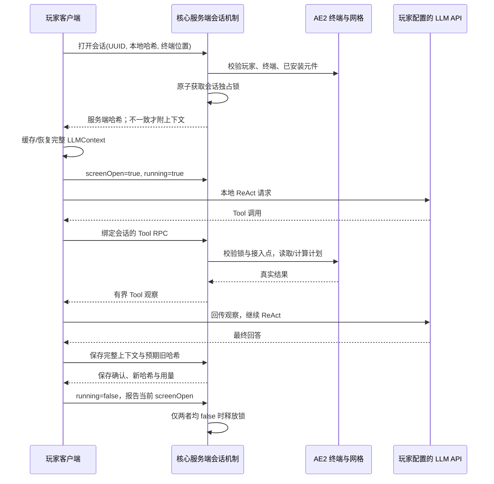

# AE2 智能存储拓展交付说明

## 1. 交付范围与依赖

实现位于 `com.rcdiamond.aifactory.addon.ae2`：五档 ME 智能元件、联网 ME 智能终端，以及库存读取、物品/NBT 详情、合成计划三项 Tool。

- AE2 为**可选依赖**。公共入口只在 `ModList.isLoaded("ae2")` 时通过类名反射加载 `Ae2Addon.initialize()`；无 AE2 时不初始化集成类、不注册拓展内容，原 G 键聊天保留。
- 接入版本精确为 **Forge AE2 15.4.11**，Minecraft 1.20.1。使用拓展时客户端与服务端均需安装 AE2、GuideME 20.1.7、Kotlin for Forge 4.12.x 和 AI-Factory。
- 发布包为 `build/libs/ai_factory-1.0.0.jar`，由 `jarJar` 和 `reobfJarJar` 生成。仅内嵌 JTokkit 1.1.0；`-plain.jar` 缺少 Tokenizer，不用于发布。AE2、GuideME、Kotlin 不内嵌。
- JTokkit 的 MIT 许可随包置于 `META-INF/licenses/jtokkit-LICENSE.txt`；元件与终端纹理为本项目原创，没有复制 AE2 美术资源。
- 本次没有增加服务端 LLM API、服务端 Provider 或服务端 ReAct。

## 2. 元件容量与持久化

按照使用者后续修订，所有档位最多 **8 个会话**，不是最初的 16 个。容量为整张元件共享额度，不提前等分，也不预留每个会话的空间。

同一 ME 网格内多张独立元件的会话配额可累加：两张最多 16 个，三张最多 24 个，仍受每张元件的实际字节预算约束。新建优先使用界面选中的元件；该元件会话槽位或字节空间不足时，服务端自动选择网格内另一张有空间的已安装元件。已有会话不迁移，不把多张元件的字节额度合并给单个会话；复制同一 UUID 的引用不增加配额。

| 档位 | ME 字节 | 总存储 Token | 最大会话数 | 8 会话均分时每会话 Token |
| --- | ---: | ---: | ---: | ---: |
| 1K | 1,024 | 32,768 | 8 | 4,096 |
| 4K | 4,096 | 131,072 | 8 | 16,384 |
| 16K | 16,384 | 524,288 | 8 | 65,536 |
| 64K | 65,536 | 2,097,152 | 8 | 262,144 |
| 256K | 262,144 | 8,388,608 | 8 | 1,048,576 |

### Token 定义

存储计费固定使用本地 **`cl100k_base`** Tokenizer 对规范化后的完整 `LLMContext` JSON 计数，包括系统/全局提示、Tool 定义、消息、历史 Tool 调用与结果。特殊 Token 标记按普通文本处理。每会话收费为 `ceil(Token / 32)` ME 字节，元件使用量为各会话收费之和；取整开销包含在容量内。

这是真正的本地分词计数，不把 UTF-8 字节数当 Token，也不采用客户端上报的 API usage。模型提供商可能使用其他 Tokenizer，API 账单用量与这里的**存储 Token**可以不同。256K 支持 8 个各 1 Mi 存储 Token 的完整上下文；提示、Tool Schema 与 JSON 结构同样占额度，不是额外免费空间。

独立安全边界：单上下文最多 `64 MiB - 4096` UTF-8 字节、200,000 条消息、JSON 深度 64。它们是传输与解析上限，不代表 ME 字节额度；极端长 Token 文本或大量短消息可能先触达安全边界。

### 存储位置与物品语义

- 元件物品 NBT 中 `ai_factory:cell_id` UUID 关联世界存档；另有只读显示缓存 `ai_factory:cell_summary`，仅包含会话标题和已使用的 AE2 字节数。不存上下文正文、API 配置或容量副本，显示缓存不参与会话归属或配额校验。会话有独立 UUID，绑定元件 UUID。
- 世界数据存于主世界 `data/ai_factory_shared_sessions.dat`，使用 `SavedData` 的压缩 NBT 字节数组封装完整 JSON。元件跨驱动器、网格或维度移动仍引用同一数据。
- 客户端缓存位于 `config/ai-factory/shared-sessions/<世界或服务器标识>/<会话 UUID>.json`，原子替换，按世界最多保留 32 项。缓存丢失只会触发重新同步。
- 自定义 `ICellHandler` / `StorageCell` 使元件可装入 ME 驱动器；库存接口不接收或产出 AE 资源，因此不会伪装成普通物品存储单元。也能发现 ME 箱子的实际元件槽，排除箱子的物品输入槽。
- 空/已用/类型满/容量满状态从真实世界数据推导，闲置能耗为各档位 0.5 / 1 / 1.5 / 2 / 2.5 AE/t。
- 清空会话清除历史，但不删除会话 UUID、不释放其“种类”槽位；可复用同一会话。没有新增删除会话、重命名或元件数据垃圾回收功能。
- 创造模式或 NBT 工具复制元件会复制引用，不产生第二份上下文或额外配额；多个引用仍受同一个会话锁约束。丢失/销毁元件不会自动删除世界中的正文。
- 损坏、未知版本或含坏记录的存档保留原始字节并进入只读保护；可读记录仍可检查，编辑被拒绝，需要恢复备份，不会自动覆盖为空存档。

### 物品悬浮提示

每个已保存会话的标题按创建顺序各占一行，随后固定显示两行：`[已使用字节] / [档位总字节] 字节已使用`、`[会话数量] / 8 会话`。字节用量是本节约定的 AE2 计费字节，即各会话 `ceil(Token / 32)` 的总和，不是 JSON/NBT 文件大小。空元件没有标题行，用量为零。

旧的 Token 预算、初始化说明、存档引用说明和自定义 UUID 提示已移除；中英文翻译同步更新。服务端在玩家 tick 中刷新玩家背包、当前打开的容器槽位和鼠标持有元件的显示摘要，通过正常物品槽位同步传给客户端。摘要不变时不重建 NBT；标题列表按元件缓存，新增会话时失效。客户端不直接读取服务端世界数据。


## 3. 模块责任与同步流程

| 模块 | 责任 |
| --- | --- |
| `shared.*` | 与 AE2 无关的上下文编码、规范化 SHA-256、计费、持久化、独占锁和服务端会话操作 |
| `network.SharedSessionNetwork` | 有界分片 RPC、响应关联与终端打开事件；不引用客户端专用类 |
| `client.shared.*` | 本地缓存与同步、会话选择、Provider 组合、共享回合生命周期、HUD |
| `client.agent.ReactAgent` | 原有 ReAct 引擎，增加完整上下文导入/导出；不认识 ME 网络 |
| `client.ui.AgentChatScreen` | 通用聊天显示与生命周期回调；由会话契约决定关闭是否取消 |
| `addon.ae2.Ae2Addon` | 唯一根包入口，负责条件注册与公共初始化；反射加载类名保持不变 |
| `addon.ae2.block.*` / `addon.ae2.blockentity.*` | ME 智能终端方块交互、掉落及方块实体的网格生命周期与授权 |
| `addon.ae2.item.*` | ME 智能元件物品与容量档位 |
| `addon.ae2.storage.*` | AE2 元件处理器、挂载库存、元件 UUID 引用与使用量读取 |
| `addon.ae2.server.*` | 共享会话后端、库存/合成工具执行与样板管理执行 |
| `addon.ae2.tool.*` | 无 Minecraft/AE2 API 依赖的共用参数校验、操作限制、库存分页与 NBT 视图 |
| `addon.ae2.client.tool.*` | 五项客户端 ME 工具的定义、校验与注册 |



规范化哈希递归排序对象键、保留数组顺序，不包含会话标题或 UUID。客户端既校验缓存正文与缓存哈希，也比较服务端哈希；一致不传正文，不一致以服务端版本替换。恢复后会重建可见聊天记录；历史 Tool 结果作为历史输入，不重放游戏操作。

每玩家同时持有至多一个共享会话，每会话同时只有一个玩家。重新打开自身正在运行的会话复用同一个客户端回合。打开失败或响应不可用时客户端尝试释放可能已获取的锁，不把失败的打开留成不可关闭的会话。

关闭聊天或会话选择界面不取消正在执行的共享回合；终端的选择界面也计入“终端已打开”。终端界面都不暂停单人游戏。后台 HUD 显示会话、状态与最后保存的用量。**最终上下文保存确认后，终端已关闭且 ReAct 已结束才释放锁**；保存失败保留本地内容与锁，显示服务端拒绝原因。普通 G 键聊天仍在关闭时取消。

保存目前在回合结束、清空、打开空闲会话或关闭空闲界面时发生，不为每个流式文本片段写世界存档。`save` 确认表示服务端内存中的 SavedData 已更新并标脏，真正落盘由 Minecraft 存档周期完成，不是同步 fsync 承诺。

传输使用 `ai_factory:shared_session` 频道、精确版本 `"2"`；原 `game_action` 协议 `"2"` 不变。`create` 响应新增实际分配的 `cellId`，客户端据此打开并跟踪会话；客户端和服务端必须同时更新，不能与共享协议 `"1"` 混用。分片 24 KiB，重组总上限 64 MiB，每连接最多 16 组且总在途正文不超过 64 MiB；拒绝乱序/超界，处理空闲过期并在退出时清理。普通 RPC 超时 30 秒，大上下文打开/保存超时 120 秒。

## 4. AE2 Tool

共享 ME 会话仅注册以下五项 Tool；不注册 `give_item` 或 `execute_command`。普通 G 键聊天保留原有工具，不凭空获得 ME 网络访问权。旧 ME 会话恢复时保留提示和历史，但以当前 ME 工具集替换保存过的 Tool Schema；历史操作不重放。

| Tool | 参数 | 结果与语义 |
| --- | --- | --- |
| `ae2_read_inventory` | `filter`、`page`、`page_size` | 当前库存与可合成项、数量、显示名、资源 ID、完整 Key 指纹、是否可合成、分页元数据；可合成但无库存的项数量为 0 |
| `ae2_item_details` | `key`，可选 `path/depth/page/page_size` | 实时确认此 Key 属于该网络，返回身份、数量、可合成状态与有界 NBT 视图；物品另含最大堆叠与损坏状态 |
| `ae2_crafting_plan` | `key`、`amount` | 真实 AE2 异步计划，包括缺料、所需 bytes、模拟状态、最终输出与相关用量；固定 `submitted=false` |
| `ae2_request_crafting` | `key`、`amount` | 为当前网络已经有样板的物品计算并提交真实 AE2 合成任务；成功 `submitted=true`，缺料或 CPU 不可用则拒绝 |
| `ae2_manage_patterns` | `action=view` 或 `encode_install`；详见下文 | AI 可读取的样板管理终端式视图，以及样板编辑、编码和指定容器槽位投放 |

`key` 是类型、资源 ID 和完整 NBT 的稳定 SHA-256，不是简单的物品 ID；不同 NBT 变体分开识别，相同名称/ID 的变体也有稳定分页。先读库存获得 `key`，再查询详情或计算计划。缓存命中仍检查 Key 当前存在于该网络或当前可合成，不能使用另一网格的缓存绕过归属检查。

NBT 路径例如 `tag.display.Name`、`tag.Items[3].id`；支持转义成员名。路径最多 16 步，显示深度最多 6、最多 512 个节点，字符串显示最多 256 字符，数组预览最多 32 项；截断显式标记，可通过路径和分页深入。每页默认 20 项，最大 100 项。

计划通过 `ICraftingService.beginCraftingCalculation(..., REPORT_MISSING_ITEMS)` 计算，服务端 tick 只在 `Future.isDone` 后读取结果，不阻塞等待。完成时重新校验终端和原会话锁/元件归属。全服最多 4 个并行计划，每玩家 1 个，240 tick 后取消（20 TPS 时约 12 秒；低 TPS 可能先触发客户端墙钟超时）。缺料最多显示 64 种并标记省略。数量范围 1–1,000,000,000。

**预览与提交分开。** `ae2_crafting_plan` 不调用 `submitJob`，不预留/提取材料；`ae2_request_crafting` 只接受当前可合成的物品 Key，拒绝缺料模拟，并在提交前重新检查同一网格、可合成性、连接、租约和智能元件仍挂载。使用 AE2 自动选择合适 CPU，返回其真实拒绝原因（忙碌、容量不足、离线或缺料等）。成功提交后，材料由 AE2 消耗，产物回到网络而不是玩家背包。服务器停止会取消未完成计算。

### 样板视图与编码

`ae2_manage_patterns` 是供模型读取的 JSON 工具视图，不是新增人类 GUI：

- `{"action":"view","filter":"","page":0,"page_size":20}` 返回容器名、`dimension`、`container`（`x,y,z/side`）、槽位数、空槽、样板指纹、模式、配方与真实输入输出。`show` 支持 `visible`、`not_full`、`all`；可用 `container` 缩小扫描范围。
- `{"action":"encode_install","dimension":"minecraft:overworld","container":"12,64,-3/block","slot":0,"expected":"empty","mode":"crafting","grid":[{"item":"minecraft:oak_log"}]}` 编码并装入该槽位。坐标只是示例，必须使用视图返回的维度与容器。已有槽位使用其 `pattern_key` 作为 `expected`，原位复用样板；空槽必须从此网络实际提取一张空白样板，没有则拒绝，不凭空创建。
- `crafting` 使用最多 9 格的 `grid`，空格写 `null`；`processing` 使用 `inputs` / `outputs` 的 `{slot,key,amount}` 列表，分别最多 81 / 27 格，主输出必须在 0 格；`stonecutting` 使用 `input` 与可选 `output` / `recipe`；`smithing` 使用 `template`、`base`、`addition`。工作台、切石和锻造输出由服务端真实配方确定；加工模式描述外部机器过程，不自动推断或验证该机器的配方。AE2 无法编码的锻造纹饰配方拒绝。
- Key 可以是视图/库存的完整指纹，或不带 NBT 的 `{"item":"namespace:path"}` / `{"fluid":"namespace:path"}`。指纹在当前网络或当前样板中重新解析，不接受任意 SNBT；加工流体数量使用 AE2 的 mB 单位。
- 安装要求目标属于当前 active 网格且在样板管理终端中可见；检查容器自身维度中的加载与 `mayInteract`，以及会话租约。目标槽位变化则拒绝，写入通过 AE2 `InternalInventory` 触发保存和合成列表刷新。失败时先恢复旧槽位，再归还已提取空白样板；网络无法接收退款时将真实物品退回玩家背包，满背包则掉落。
- 单次扫描最多 256 个容器、1024 个样板槽位；截断通过 `scan_truncated` 报告，容器的空槽列表最多 64 个。单份原生加工样板完整显示最多 81 个输入与 27 个输出。大型网络可指定 `container` 查看目标；安装按维度与容器定位，避免量子桥两端相同坐标误投放。

## 5. 授权、兼容与边界

### 正常授权

- 终端使用前检查服务端、同维度、已加载区块、真实终端方块实体、`Level.mayInteract`、距离不超过 8 格、节点 active（电力与通道有效）。查询不会为任意客户端坐标强制加载区块。
- 保存/Tool/状态必须匹配连接真实发送者持有的会话锁、绑定终端与已安装元件。后台回合仅放宽距离，不放宽维度、加载、权限与网格可用性。
- 服务端不相信客户端的玩家 UUID、容量、Token 数、任意网格对象或操作名。保存还有旧哈希一致性检查与整张元件容量检查，拒绝时不修改原上下文/配额。
- AE2 15.4.11 没有旧安全终端的 `ISecurityService`。本实现是物理接入与原版交互权限，不增加网络所有者 ACL。领地/第三方保护 Mod 的完整兼容性未经验证；能合法接近终端的玩家可能读取其网络中的共享会话与库存。
- 系统和全局提示、Tool 结果会分享给后续会话使用者。Provider 配置与 API 密钥不属于 LLMContext，也不会由同步机制传输；用户自行写进消息或提示的敏感内容仍会正常存入共享上下文，应避免这样使用。

### AE2 内部耦合

查询/合成以公开 `appeng.api.*` 为主，终端生命周期、驱动器访问和样板容器发现/模式详情仍耦合 AE2 内部公开 Java 类，包括 `PatternContainer`、`PatternProviderLogicHost` 和四种原生样板实现。这些不属于稳定 API，因此版本**精确锁定 15.4.11**，没有承诺未来 15.x 兼容。

驱动器状态来自外部世界数据，不来自物品插入/提取。后台保存后 LED 刷新由终端交互触发，可能落后一个交互；终端使用量与服务端容量校验从实时数据读取。元件不支持普通存储单元的分区/工作台 UI。

### 本次不承诺的极端恢复

1. **突然掉线**：客户端取消 scope；服务端正常收到退出事件时释放锁。尚未保存的回合内容可能丢失，不恢复模型流，也不自动重放 Tool。不是分布式租约或网络分区恢复协议。
2. **区块卸载、终端拆除、断电/失去通道、切维度**：随后保存/Tool/状态校验失败，后台回合可能拿到拒绝观察，最终内容可能只留在客户端内存；锁可能保留到接入恢复、正常退出或服务端停止。没有强制保持区块加载或迁移回合接入点。
3. **服务器崩溃/重启**：锁不持久化；未到世界落盘周期的已确认保存也可能丢失。下一次打开以服务端持久化哈希为准，不用客户端缓存偷偷覆盖较旧的存档。
4. **容量已满或只读存档**：保留未保存内容与锁，不截断历史，也不报告保存成功。容量问题可清空当前历史后保存；只读损坏数据需要恢复备份。清空不一定能克服其他会话已占满容量、提示/Schema 本身过大或元件不再安装的问题。
5. **低 TPS/Tool 超时**：回合收到超时观察，不自动重试。只读计划没有世界副作用；合成请求或样板安装可能已经完成，客户端超时/取消不会撤销它们，应先检查网络实际状态，再决定是否重复操作。
6. **本地缓存与世界备份**：服务器地址/LAN 地址复用可能共享缓存目录；会话 UUID 和正文哈希仍需一致，否则重新同步。离线读取缓存不是取得服务端编辑权。

## 6. 使用与游戏内验收

1. 配好客户端 `config/ai-factory/model.toml` 与 `agent.toml`；每位使用者调用自己的 API。共享上下文不是共享密钥。
2. 创造模式在“AI-Factory 智能存储”页取得元件与终端，或使用新增配方。元件配方使用对应 AE2 存储组件、物品元件外壳、逻辑处理器；终端使用 AE2 终端、计算处理器与铁锭。
3. 把元件装入 ME 驱动器，终端连入同一有电且有通道的 ME 网络。右键终端选择优先元件，新建命名会话或打开已有会话；选中元件满额时，新会话自动使用其他有空间的元件，无需手动切换。
4. 请求库存，使用返回 Key 查询 NBT、预览计划，再明确请求合成指定数量；检查 CPU 中的真实任务与最终网络产物。验证未编码物品、缺料、CPU 忙碌/容量不足均不误报提交成功。通过样板 `view` 读取容器，以 `expected` 编码并投放四种模式；核对消耗空白样板、已有样板复用、配方输出及新样板被 AE2 识别。槽位变更、无空白样板、隐藏容器、权限拒绝及量子桥两端同坐标不得误写。
5. 两名玩家同时打开同一会话，应只有一名成功。第一名关闭界面但仍有 ReAct 时，第二名仍被拒绝；前者 HUD 应持续显示。保存完成且终端关闭后第二名才能接手并看到新历史。
6. 检查同 UUID/同哈希时不传正文，不同哈希时同步；检查离开世界/保存重启、元件移至另一驱动器后仍能恢复。
7. 检查每张元件八会话上限：同驱动器安装两张独立元件，保持选中第一张连续创建 16 个会话，确认第 9 个开始使用第二张，第 17 个被拒绝；增加第三张并刷新后应可继续创建。拔掉有空余配额的元件后不得再分配到它；字节满但会话槽位未满时也应使用另一张元件。另检查整盘容量超限不改旧数据、清空后保存、同名不同 NBT 变体、可合成但零库存的 Key、NBT 分页与截断。
8. 分别在有/无 AE2 的客户端与独立服务端环境加载；检查模型、名称、配方、放置、破坏掉落、电源/通道与 HUD。独立服务端 EULA 必须由使用者自行阅读接受。

这些是实际游戏验收步骤，不以构建、单元测试或独立 JVM 烟测代替。按项目约束，本次没有启动 Minecraft 客户端、独立服务端或 GameTestServer。

## 7. 基础版本已执行验证

正式构建命令：

```powershell
. .\Set-DevEnv.ps1
.\gradlew.bat build --console=plain
```

结果：`BUILD SUCCESSFUL`，`jarJar`、`reobfJar`、`reobfJarJar` 均执行。19 个测试类共 **204 项本地测试通过**，失败/错误/跳过均为 0；默认不执行付费 API 集成测试。

另外运行了独立 JVM 烟测，临时源码、初始化脚本和类文件验证后移除：

- 写入并读取真实压缩 NBT 临时文件，确认会话 UUID、完整消息历史、哈希与 ME 字节计费保持一致。
- 实际调用独占锁，覆盖关闭界面仍运行、界面打开但空闲、关闭且完成、第二玩家争用和随后接手。
- 直接执行生产 RPC 分片重组，确认正文恢复与乱序丢弃；该 JVM classpath 排除 AE2 和 GuideME，并完成公共入口/核心签名链接。
- 使用真实本地 HTTP SSE 服务与生产 `OpenAICompletion` / `ReactAgent`，从持久化上下文恢复后发起下一回合；HTTP 请求包含原系统/全局提示与历史，导出历史继续追加。该样本为 214 UTF-8 字节、46 个 `cl100k_base` Token，证明字节数未冒充 Token 数。另有回归测试确认恢复含 Tool 结果的历史不会重放过去的游戏操作。
- 校验原创纹理引用、模型父模型及 JSON；共享 UI/HUD/元件提示的 34 个翻译键在中英文资源中全部存在。
- 检查最终发布 JAR：224 个 Mod 类均为 Java 17 字节码；37 个非客户端/非 addon 公共类没有 AE2 或 Minecraft 客户端类的直接 Class 引用；元数据变量已展开、AE2 为精确可选依赖、6 个配方附加 Mod 加载条件、掉落使用无 AE2 时仍可解析的动态条目。
- Jar-in-Jar 仅含 JTokkit 1.1.0，包含词表与 MIT 许可；没有 AE2/GuideME/Kotlin 副本、真实密钥配置或烟测类。

无 AE2 的独立 JVM 链接检查不是 Forge 引导证明；压缩 NBT/HTTP/锁烟测也不是已进入世界的证明。实际驱动器插入、接线、电力/通道、终端显示、HUD、多人同步、独立服务端与发布环境加载仍按第 6 节进行游戏内验收。

## 8. 合成请求与样板管理增量验证

- `build ae2ToolSmoke -I .gradle/ae2-tool-smoke/smoke.gradle --console=plain` 成功，执行发布打包及两种重混淆。20 个测试类共 **214 项本地测试通过**，失败、错误和跳过均为 0；新增 10 项样板参数回归覆盖模式互斥、主输出、槽位/数量上界、期望内容、非法 Key 和维度标识。
- 独立 JVM 实际运行 `Ae2Tools` / `ToolManager`：五项 ME 工具存在，`give_item` / `execute_command` 返回 `unknown_tool`；合成零数量/整数溢出、未知样板动作以及安装缺少维度均在到达网关前拒绝。样板参数烟测保持下界/最高输入槽 80、1000 mB 流体量和 `minecraft:the_nether` 容器维度。
- 发布 JAR 包含合成请求、样板管理工具及服务端执行/校验类；Mod 字节码为 Java 17，`mods.toml` 变量已展开，Jar-in-Jar 仍仅含 JTokkit。已编译的共享助手类不再引用给予、命令工具或 `ClientGameActions`，不含烟测类。临时烟测源、任务与类文件已移除。
- 额外尝试在独立 JVM 引导 Minecraft 并调用 AE2 物品/加工样板 API，失败在 Forge `NetworkEvent` 监听器初始化：该 JVM 缺少正常 Forge 启动时的事件类转换（`NoSuchMethodException: NetworkEvent.<init>()`）。这不是游戏加载或样板 API 验收通过的证据，也未为绕过它修改生产逻辑。

未启动客户端、独立服务端或 GameTestServer；真实 CPU 合成、四种样板投放、权限、跨维度容器和界面加载仍按第 6 节进行游戏内验收。纯工具烟测和参数测试不代替这些检查。

## 9. AE2 package 重构验证

- 将内容定义、存储适配、服务端执行、共用工具契约与客户端工具分包；测试同步迁至 `addon.ae2.tool` 和 `addon.ae2.client.tool`。本次只调整文件位置、package 和 import，不改变可见性、注册 ID、NBT、协议或运行逻辑，也不保留旧包别名。
- 执行 `build ae2PackageSmoke ae2PackageArchiveCheck -I .gradle/ae2-package-smoke/smoke.gradle --console=plain` 成功，包含 `reobfJar` 与 `reobfJarJar`；全部 **214 项本地测试通过**，其中 AE2 测试 38 项，失败和跳过均为 0。
- 独立 JVM 运行迁移后的 `Ae2Tools` / `ToolManager`，确认五项工具注册，非法参数在到达游戏网关前拒绝；实际运行规范化 NBT 指纹、共享 Key/路径校验及 NBT 导航/渲染。
- 检查发布包 `build/libs/ai_factory-1.0.0.jar` 中 26 个迁移类、入口及文件级辅助类：新 package 路径齐全，旧 AE2 根包内容类和旧 `addon.ae2.client` 工具类无残留；`mods.toml` 已展开，客户端资源与服务端数据存在，未包含烟测类。临时烟测源、任务与类文件已移除。
- 未启动客户端、独立服务端或 GameTestServer；构建和独立 JVM 工具烟测不代表游戏内注册、加载及世界交互验收通过。


## 10. 多元件会话扩容修复

- 修复新建会话仅使用选中元件、满额后不利用其他已安装元件的问题。服务端同时检查每张元件的会话数和剩余字节；所有元件都无空间时拒绝创建，不修改已有数据。
- 创建响应返回实际元件 UUID；客户端不再把优先元件误记为会话归属，共享协议升级为 `"2"`。存档格式保持不变，无需迁移元件 UUID 或已有会话。
- 执行 `build` 与临时 `ae2CapacitySmoke`，结果为 `BUILD SUCCESSFUL`，包括重混淆打包和全量本地测试。新增 7 项回归覆盖优先选择、两元件 16 会话、动态挂载/卸载、字节满额、未挂载 ID、重复引用和只读/标题校验。
- 独立 JVM 烟测调用生产会话存储和 SavedData：两元件容纳 16 个会话并拒绝第 17 个；真实压缩 NBT 写入/重载保持全部记录；新增第三元件后第 17 个会话分配到它，第一张元件的用量不变。临时烟测文件已移除。
- 未启动 Minecraft 客户端、独立服务端或 GameTestServer；真实驱动器槽位发现、界面显示和 Forge 握手仍按第 6 节游戏内验收。


## 11. 元件物品提示增量验证

- 执行 `build ae2TooltipSmoke`，结果为 `BUILD SUCCESSFUL`，包括全量本地测试、`reobfJar` 和 `reobfJarJar`。新增标题缓存回归验证元件隔离、顺序、新建后的刷新及存档重载。
- 独立 JVM 运行生产摘要刷新与提示构建代码，使用实际中文资源解析 Component：两个标题后显示 `2 / 1024 字节已使用`、`2 / 8 会话`；保存较大上下文并新建会话后显示三个标题、`34 / 1024 字节已使用`、`3 / 8 会话`。
- 烟测覆盖五档空元件容量、摘要不变时保留 NBT、真实 `FriendlyByteBuf` 的 NBT 编解码后提示一致、错误显示用量被世界存档修正及无引用时清除旧摘要。临时烟测源、任务与类文件已移除。
- 初次尝试完整 ItemStack 烟测时，Minecraft Bootstrap 在 Forge `NetworkEvent` 的事件类转换缺失处失败；最终烟测不启动游戏，也不宣称已验证完整物品包或菜单 tick 的实际联网同步。真实悬浮框渲染、多人容器刷新和独立服务端加载仍需游戏内验收。

